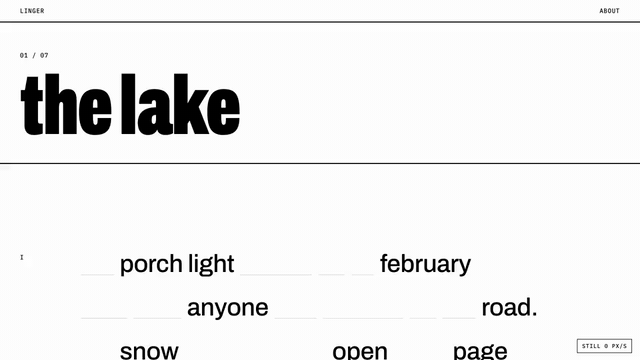

# linger

Poems for the in-between hours. Each line starts as a few words in white space,
and the rest fills in while you hold still. This repo is the whole site, live at
[linger.joekarlsson.com](https://linger.joekarlsson.com/): plain HTML, CSS and a
little JavaScript, no build step.



## Artist statement

Almost everything on the web wants to move you along. linger is seven poems that
only finish if you slow down. Paper has no idea how fast you're reading, and a
web page does, so I made speed the thing that decides which words you get.

[Read the full statement](https://www.joekarlsson.com/work/linger/).

## Quick start

```bash
git clone https://github.com/JoeKarlsson/linger.git
cd linger
open index.html
```

## Writing a poem

Poems live in [`poems.js`](poems.js). A plain word is always there. A word
marked `^` comes when you pause, and a word marked `~` comes only if you stay.

```js
"~the call ^came ~at five-forty: no school.",
```

## Development

There are no tests or build. GitHub Pages serves `main` at the custom domain in
`CNAME`, so a push to `main` is a deploy.

## License

Poems [CC BY-NC-ND 4.0](https://creativecommons.org/licenses/by-nc-nd/4.0/).
Code MIT. See [LICENSE](LICENSE).
