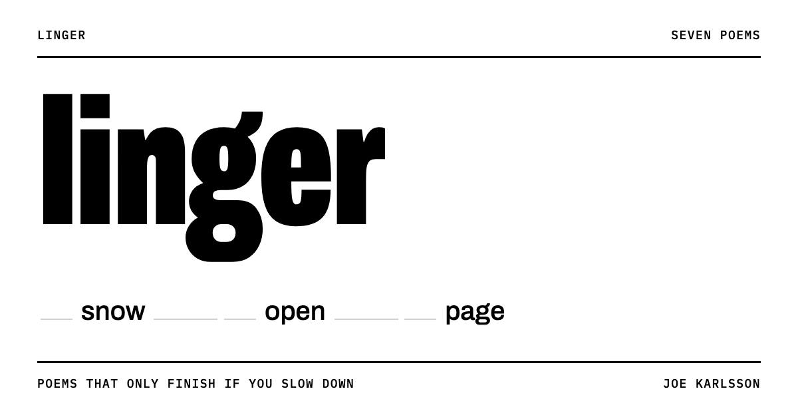

# linger

Poems for the in-between hours. Stay a while, and the words will come.

**[linger.joekarlsson.com](https://linger.joekarlsson.com/)**

[](https://linger.joekarlsson.com/)

The driveway before you go inside. A snow day. The power going out. Four hundred miles of the same field. A Sunday with nothing in it.

Each poem arrives as a few words in a lot of white space. Hurry past, and that is all you get. Stay, and the rest fills in around them.

## Recording (November 2026)


What linger looked like in November 2026, recorded for [its page on joekarlsson.com](https://www.joekarlsson.com/work/linger/). The full-quality video is [2026-11-recording.mp4](.github/readme/2026-11-recording.mp4).

## Writing a poem

Poems live in [`poems.js`](poems.js). A plain word is always there. A word marked `^` comes when you pause, and a word marked `~` comes only if you stay.

```js
"~the call ^came ~at five-forty: no school.",
```

## License

Poems [CC BY-NC-ND 4.0](https://creativecommons.org/licenses/by-nc-nd/4.0/). Code MIT. See [LICENSE](LICENSE).

By [Joe Karlsson](https://joekarlsson.com).
