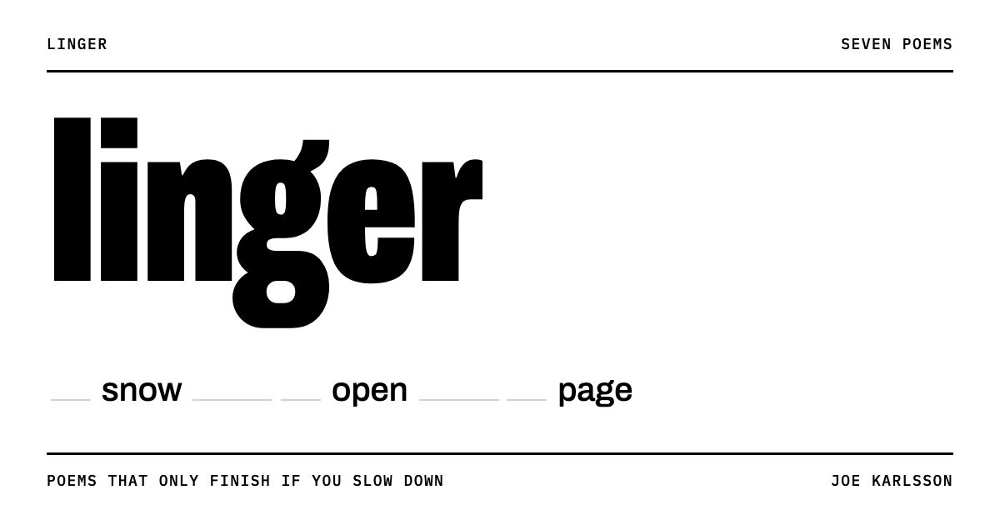

# linger

Poems that only finish if you slow down.

**Read it at [linger.joekarlsson.com](https://linger.joekarlsson.com/)**

[](https://linger.joekarlsson.com/)

Most of the web is built to move you along. linger reverses that. Each line of each poem starts as a skeleton of a few words. Hold still and the blanks fill in; scroll fast and they drain away again. The skeleton is its own sparser poem, closer to a weather report than a memory. The full poem is there only for readers who stay with each line for a few seconds.

## The poems

| # | Poem | Lines |
|---|------|-------|
| 01 | [the lake](https://linger.joekarlsson.com/poem.html?p=the-lake) | 12 |
| 02 | [the driveway](https://linger.joekarlsson.com/poem.html?p=the-driveway) | 11 |
| 03 | [counting](https://linger.joekarlsson.com/poem.html?p=counting) | 12 |
| 04 | [snow day](https://linger.joekarlsson.com/poem.html?p=snow-day) | 12 |
| 05 | [outage](https://linger.joekarlsson.com/poem.html?p=outage) | 12 |
| 06 | [four hundred miles](https://linger.joekarlsson.com/poem.html?p=four-hundred-miles) | 14 |
| 07 | [sunday](https://linger.joekarlsson.com/poem.html?p=sunday) | 12 |

## Three readings

Every line can be read three ways, depending on how long you stay with it:

| Reading | When | Example |
|---------|------|---------|
| Skim | Scrolling faster than 700 px/s | `· snow · · · open · · page` |
| Pause | Still for about 1.2 seconds | `· snow · it lay open · a page` |
| Linger | Still for about 3.6 seconds | `the snow beneath it lay open like a page` |

Skimming drains a line four times faster than holding still fills it. A small meter in the corner shows your speed, and scrolling very fast once brings up a single "slower."

## Adding or editing a poem

All poems live in [`poems.js`](poems.js). Each line is written once, and a prefix sets when a word appears:

- no prefix: always visible (the skim reading)
- `^word`: appears after a short pause
- `~word`: appears only if you linger

```js
{
  slug: "snow-day",          // the poem's address: poem.html?p=snow-day
  title: "snow day",
  stanzas: [
    [
      "~the call ^came ~at five-forty: no school.",
      "~by ^seven ~the street ^was ~a white field",
      // ...
    ],
  ],
},
```

Write the skim words first and read them on their own; they should hold up as a poem. The home page list, numbering, and next-poem links all build themselves from this file, in its order.

Timing values (`FAST`, `STILL`, `PAUSE_AT`, `LINGER_AT`, `DRAIN`) are at the top of the script in [`poem.html`](poem.html).

## Files

| File | What it is |
|------|------------|
| `index.html` | Home page and poem list |
| `poem.html` | Displays any poem, plus the bloom engine |
| `poems.js` | The poems |
| `about.html` | Artist statement and colophon |
| `404.html` | Shown for any missing page (uses absolute URLs, since it can be served at any path) |
| `style.css` | Shared styles, light and dark |
| `og.png` | Link preview image (1200×630) |
| `favicon.svg`, `apple-touch-icon.png` | Icons |
| `CNAME` | Custom domain for GitHub Pages |

Plain HTML, CSS, and JavaScript, set in Archivo and IBM Plex Mono. No build step, no cookies, no analytics.

## Running locally

```sh
python3 -m http.server 8765
```

Then open http://localhost:8765.

## Deploying

GitHub Pages serves the `main` branch at [linger.joekarlsson.com](https://linger.joekarlsson.com/). Push to `main` and it is live within a minute or two. Old `joekarlsson.github.io/linger` links redirect to the custom domain.

The domain is a `CNAME` record for `linger` pointing to `joekarlsson.github.io` in Cloudflare, set to DNS only (grey cloud) so GitHub can issue the HTTPS certificate.

## License

The poems are CC BY-NC-ND 4.0: share them with credit, but don't sell or alter them. The code is MIT, so reuse the bloom effect however you like. See [LICENSE](LICENSE).

By [Joe Karlsson](https://joekarlsson.com).
